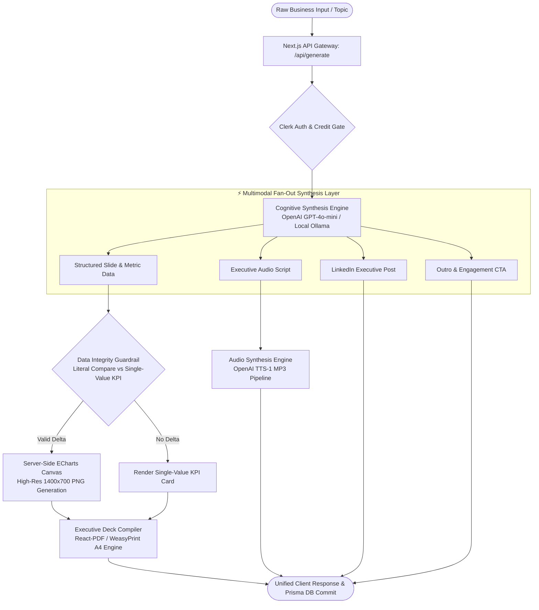

<div align="center">

# 📊 Story Generator Executive — Multimodal B2B Engine
### Autonomous Content Engine Synthesizing Executive Decks, ECharts, Social Carousels & TTS Audio

[](https://nextjs.org/)
[](https://react.dev/)
[](https://www.typescriptlang.org/)
[](https://openai.com/)
[](https://echarts.apache.org/)
[](https://www.prisma.io/)
[](https://tailwindcss.com/)

<p align="center">
  <a href="#-executive-summary">Executive Summary</a> •
  <a href="#-multimodal-synthesis-architecture">System Architecture</a> •
  <a href="#-core-engineering-innovations">Core Innovations</a> •
  <a href="#-data-integrity--anti-hallucination-guardrails">Data Integrity Guardrails</a>
</p>

</div>

---

## 📌 Executive Summary

B2B leadership and go-to-market teams spend hours manually translating business insights into disparate formats: presentation slides for board meetings, data visualizations for executive briefings, concise copy for LinkedIn thought leadership, and scripts for audio briefings.

**Story Generator Executive** is an autonomous, multimodal generative engine built on **Next.js 14, TypeScript, and Python/Node backend utilities**. Given a single raw business topic or quantitative prompt, the system executes an automated fan-out pipeline synthesizing:
1. **Executive Board Decks:** A4 Landscape presentation decks complete with KPI cards and corporate design palettes.
2. **Deterministic Data Visualizations:** Server-side rendered vector charts (**Apache ECharts**) with strict zero-hallucination boundaries.
3. **LinkedIn Social Carousels & Posts:** High-engagement 1080x1080 carousel slide series and matching social copy with automated CTAs.
4. **Synthesized Audio Briefings (TTS):** Studio-grade spoken-word podcasts utilizing OpenAI's `tts-1` audio pipeline.

---

## 🏛️ Multimodal Synthesis Architecture

The engine coordinates multiple rendering targets, transactional billing quotas, and cognitive validation layers across an asynchronous fan-out topology:




---

## 🔬 Core Engineering Innovations

### 1. Multi-Artifact Fan-Out Pipeline
A single API invocation atomically generates four discrete enterprise media formats within one transaction:
* **Audio Synthesis:** Streams generated narration scripts into OpenAI’s audio engine (`tts-1` with voices such as `nova`, `alloy`), encoding payloads directly as base64-streamed MP3s.
* **Social Carousel Mode:** Dynamically reformats horizontal executive slide layouts into square `1080x1080` social carousels with specialized visual contrast and slide transitions.
* **Copywriting Hook Synthesis:** Extracts core value propositions into structured, ready-to-publish LinkedIn posts complete with strategic formatting and hashtags.

### 2. Server-Side Headless Graphic Synthesis (Node-Canvas + ECharts)
Rather than relying on fragile client-side chart rendering or unstyled vector approximations, the backend leverages **Apache ECharts 6.x** paired with **Node-Canvas (`canvas`)**:
* Charts are compiled into high-resolution PNGs (`1400x700` for presentation decks, `1080x600` for carousels) directly in memory before response dispatch.
* Images are embedded inline into the slide payloads, guaranteeing pixel-perfect PDF and browser rendering across all operating systems without layout drift.

### 3. Dual-Stack Deployment (Hybrid Next.js + Python Pipeline)
The system supports both full-stack TypeScript execution and headless Python microservice workers:
* **TypeScript Runtime (`route.ts`):** High-concurrency Next.js App Router gateway handling authentication, Stripe quotas, and server-side canvas generation.
* **Python Runtime (`story_generator.py`):** Standalone Pydantic-validated pipeline with automatic Unicode and Mojibake sanitization (`normalize_unicode`), local Ollama (`qwen2.5-coder`) switching, and WeasyPrint A4 landscape compilation.

---

## 🛡️ Data Integrity & Anti-Hallucination Guardrails

Visualizing business data requires absolute mathematical truth. Generic LLMs routinely hallucinate relative comparison bars (e.g., fabricating a "Before: 20% vs. After: 80%" metric from purely qualitative text).

The engine enforces strict heuristics outlined in `PROMPT_RULES.md`:
1. **The Literal Number Rule:** The model is prohibited from constructing `ist`/`soll` comparison bars unless the input text contains two explicitly stated numeric values.
2. **Graceful Fallback to Single-Value Cards:** If a topic discusses qualitative optimizations without concrete numeric pairs, the chart data defaults to `bars: []`. The UI automatically falls back to an uncluttered, high-impact single-value metric card or qualitative strategic target.
3. **Directional Logic Constraints:** Reductions (e.g., cost cuts, emissions decreases) are mathematically verified so that positive progress never displays negative inverted delta indicators. Reductions are bounded strictly $\le 100\%$.


## 🛠️ Enterprise Tech Stack
```
| Layer | Technology | Architectural Purpose & Implementation Specs |
| :--- | :--- | :--- |
| **Application Framework** | **Next.js 14 (App Router)** | High-concurrency server actions, edge routing & transactional endpoint execution |
| **Frontend Architecture** | **React 18 & TypeScript** | Component-driven UI, reactive slide previewers & audio streaming players |
| **Cognitive Synthesis** | **OpenAI API & Ollama** | Structured JSON generation via `gpt-4o-mini` with local `qwen2.5-coder` fallback |
| **Audio Synthesis (TTS)** | **OpenAI TTS-1** | Studio-grade text-to-speech generating base64-encoded streaming MP3 audio |
| **Headless Visualization**| **Apache ECharts 6.x + Canvas** | Server-side chart compilation (`node-canvas`) into standalone high-res PNG buffers |
| **Document Compilers** | **WeasyPrint & React-PDF** | Precision A4 landscape PDF layout generation with CSS Paged Media standards |
| **Data Layer & ORM** | **Prisma 5 & SQLite / Postgres** | Type-safe persistence for story scripts, audio metadata, and credit balances |
| **Authentication & AuthZ**| **Clerk (`@clerk/nextjs`)** | JWT session verification, role protection & user identity management |
| **Monetization & Credits** | **Stripe 14.x** | Credit metering deducting generational balance in atomic database transactions |
| **Styling & Design System**| **Tailwind CSS v3.4** | Modern dark-mode palette (`Slate 900`), responsive layout grids & custom keyframes |
```
---

## 📂 Repository Topology

```text
story-generator-b2b/
├── src/
│   ├── app/
│   │   ├── api/
│   │   │   └── generate/
│   │   │       └── route.ts          # Core Next.js API Gateway (Credit gate, Fan-out, TTS)
│   │   ├── pricing/                  # Stripe checkout & credit package selection
│   │   ├── layout.tsx                # Root layout with Clerk Auth Provider
│   │   ├── page.tsx                  # Main interactive generation workspace
│   │   └── globals.css               # Tailwind directives & custom CSS animations
│   │
│   ├── components/
│   │   ├── ExecutiveSlides.tsx       # Live presentation slide deck renderer
│   │   ├── CarouselSlides.tsx        # 1080x1080 square social media carousel view
│   │   ├── ExecutiveAnalytics.tsx    # Dynamic KPI metric cards & chart containers
│   │   ├── AudioInput.tsx            # Voice prompt selection & audio waveform playback
│   │   ├── StoryCard.tsx             # Narrative script preview viewport
│   │   ├── ShareDropdown.tsx         # Multi-format export trigger (PDF, PNG, Audio)
│   │   └── pdf/
│   │       └── ExecutivePdfDocument.tsx # React-PDF compilation template
│   │
│   ├── lib/
│   │   ├── openai.ts                 # Structured prompt contracts & TTS synthesis
│   │   ├── db.ts                     # Prisma client singleton instance
│   │   ├── stages.ts                 # Target audience stage definitions & fallback logic
│   │   └── stripe.ts                 # Stripe billing & checkout session handlers
│   │
│   ├── utils/
│   │   ├── generateChartImage.ts     # Headless ECharts & node-canvas rasterization engine
│   │   └── sanitizeSlides.ts         # Data integrity validation & Mojibake string cleanup
│   │
│   └── types/
│       └── generator.ts              # Pydantic-equivalent TypeScript DTOs & schemas
│
├── prisma/
│   ├── schema.prisma                 # Database schema (User, AudioStory, CreditLedger)
│   └── dev.db                        # Local development SQLite database
│
├── story_generator.py                # Standalone Python microservice (Pydantic, Ollama, TTS)
├── generate_report.py                # Headless WeasyPrint A4 landscape PDF generator
├── PROMPT_RULES.md                   # Strict data integrity & anti-hallucination chart rules
├── package.json                      # Node.js dependencies & execution scripts
├── tailwind.config.js                # Custom slate palette & typography rules
└── tsconfig.json                     # Strict TypeScript compiler options
```

---

## ⚡ Quickstart & Local Setup

### Prerequisites
* **Node.js 18.17+** & npm
* **Python 3.10+** (for Python microservice utilities)
* **OpenAI API Key** (for production inference) or **Ollama** running locally

### 1. Clone & Configure Environment

```bash
# Clone repository
git clone https://github.com/your-username/b2b-executive-story-generator.git
cd b2b-executive-story-generator

# Install frontend & API dependencies
npm install

# Configure environment variables
cp .env.example .env.local
```

Populate `.env.local` with your configuration:
```env
OPENAI_API_KEY="your-openai-api-key"
NEXT_PUBLIC_CLERK_PUBLISHABLE_KEY="your-clerk-publishable-key"
CLERK_SECRET_KEY="your-clerk-secret-key"
STRIPE_SECRET_KEY="your-stripe-secret-key"
DATABASE_URL="file:./dev.db"
```

### 2. Initialize Database & Run Full-Stack Engine

```bash
# Generate Prisma Client & sync database schema
npx prisma db push

# Launch development server
npm run dev
```
> The generative workspace is now accessible at `http://localhost:3000`.

### 3. Optional: Standalone Python Microservice Execution

To test the headless Python pipeline running WeasyPrint A4 PDF compilation and local Ollama inference:

```bash
# Install Python worker dependencies
pip install openai pydantic weasyprint

# Execute headless story & slide synthesis
python story_generator.py

# Generate standalone A4 landscape executive report PDF
python generate_report.py
```
> Outputs pixel-perfect `b2b_executive_report.pdf` in the project root.

---

## 📡 API Specification

### `POST /api/generate`
Atomic endpoint orchestrating user authentication, credit verification, multimodal text synthesis, chart rasterization, and TTS audio encoding.

#### Request Payload
```json
{
  "topic": "B2B SaaS Net Revenue Retention expansion through automated onboarding",
  "targetAudience": "Entscheider",
  "stage": "executive-deck",
  "format": "executive-deck",
  "voice": "nova",
  "language": "Deutsch"
}
```

#### Response Structure
```json
{
  "success": true,
  "storyText": "In einem Markt, in dem Akquisitionskosten steigen, wird Net Revenue Retention zum primären Werttreiber...",
  "linkedInPost": "🚀 124% NRR ist kein Zufallsprodukt, sondern das Resultat systematischer Onboarding-Pfade...",
  "slides": [
    {
      "slideNumber": 1,
      "title": "NRR-Optimierung als Wachstumshebel",
      "subtitle": "Steigerung der Net Revenue Retention um +4.1% durch automatisierte Meilensteine",
      "bulletPoints": [
        "Verkürzung der Time-to-Value um 35 %",
        "Reduktion der Onboarding-bedingten Abwanderung"
      ],
      "chartData": {
        "label": "Retention Metrics",
        "value": "124% NRR",
        "comparison": "+4.1% vs Q1",
        "bars": [
          { "label": "Cohort A", "ist": 78, "soll": 92 },
          { "label": "Cohort B", "ist": 65, "soll": 88 }
        ]
      },
      "chartImage": "data:image/png;base64,iVBORw0KGgoAAAANSUhEUgAABXgAAAL..."
    }
  ],
  "outro": {
    "ctaText": "Vereinbaren Sie eine strategische Retentions-Analyse.",
    "websiteUrl": "https://landmansit.de"
  },
  "audioBase64": "UklGRiYAAABXQVZFZm10IBAAAAABAAEA...",
  "mimeType": "audio/mpeg"
}
```

---

## 👨‍💻 Engineering & Systems Architecture

Architected by **Elvijs Landmans** ([landmansIT](https://landmansit.de)).

* **Multimodal Coherence:** Orchestrating text, high-resolution vector charts, and spoken voice from a single cognitive prompt.
* **Deterministic Visualization:** Establishing strict prompt guardrails that prevent statistical hallucinations in executive decision decks.
* **Production-Grade Dual Stack:** Unifying high-concurrency TypeScript web gateways with high-precision Python PDF rendering utilities.

---

## 📄 License

Proprietary Software. All Rights Reserved. Developed for enterprise communication and generative content workflows.
